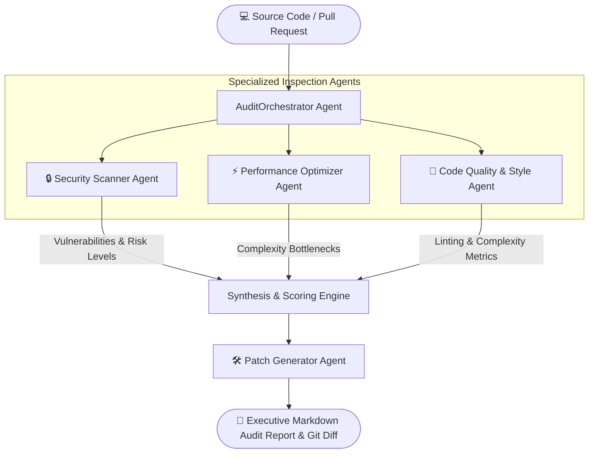

# 🛡️ Autonomous Code Reviewer Agent

[](https://www.python.org/)
[]()
[]()
[](LICENSE)

An intelligent, autonomous **Multi-Agent Static Code Analysis & PR Review Framework** engineered for Computer Science students and engineering teams to automate code smell identification, vulnerability detection, and algorithmic optimization.

---

## 📌 Problem Statement

In modern software development and university team projects:
1. **Security Vulnerabilities Escaping Review**: SQL injection, hardcoded secret tokens, and insecure deserialization routinely slip past manual peer reviews.
2. **Algorithmic Inefficiencies**: Novice programmers frequently implement quadratic time complexity ($O(N^2)$) loops and leave resource handles unclosed.
3. **Inconsistent Code Quality**: Lack of adherence to PEP8 standards, absent documentation, and excessive cyclomatic complexity make codebases unmaintainable.

**Autonomous Code Reviewer Agent** solves this by deploying specialized, collaborative software agents that inspect code in parallel, cross-validate findings, and generate production-ready patch diffs.

---

## 🧠 Multi-Agent Architecture



---

## 🤖 Specialized Agent Specifications

| Agent | Responsibility | Inspection Technique | Primary Triggers |
| :--- | :--- | :--- | :--- |
| **`SecurityScannerAgent`** | Detects critical security hazards & credential leaks | AST tokenization & pattern heuristics | SQL Injection, `eval()` misuse, exposed API keys |
| **`PerformanceAgent`** | Pinpoints latency traps & memory inefficiencies | AST nested loop traversal & I/O tracing | Nested list traversals, unclosed files, inefficient concatenations |
| **`QualityAgent`** | Enforces clean code principles & cyclomatic metrics | Static cyclomatic complexity & docstring check | High branching factor, naming violations, bloated functions |
| **`PatchGeneratorAgent`** | Constructs drop-in Git diff remediations | Automated template rewrite engine | Synthesizes sanitized queries, context managers |
| **`AuditOrchestrator`** | Calculates composite code health score (A to F) | Weighted rubric aggregator | Generates final GitHub PR review comment |

---

## 📂 Repository Structure

```text
Autonomous-Code-Reviewer-Agent/
├── README.md                  # Complete architecture documentation & viva prep
├── requirements.txt           # Minimal dependencies
├── .gitignore                 # Python exclusions
├── demo.py                    # Zero-dependency interactive demo with colored output
├── main.py                    # CLI entrypoint for analyzing custom Python files
├── samples/
│   ├── vulnerable_code.py     # Deliberately vulnerable sample script
│   └── clean_code.py          # Optimized, secure reference implementation
└── src/
    ├── __init__.py
    ├── orchestrator.py        # Central multi-agent audit coordinator
    └── agents/
        ├── __init__.py
        ├── security_agent.py
        ├── performance_agent.py
        ├── quality_agent.py
        └── patch_generator_agent.py
```

---

## ⚡ Quickstart & Setup

### 1. Prerequisites
- Python 3.8 or higher.
- Runs natively on Python standard library without requiring external keys.

### 2. Clone the Repository
```bash
git clone https://github.com/ROOPESH23-GIT/Autonomous-Code-Reviewer-Agent.git
cd Autonomous-Code-Reviewer-Agent
```

### 3. Run the Live Demonstration
Execute the automated review against `samples/vulnerable_code.py`:

```bash
python demo.py
```

### 4. Audit Your Own File
```bash
python main.py --file samples/vulnerable_code.py
```

---

## 🖥️ Sample Run Output

```text
=================================================================
🛡️ AUTONOMOUS CODE REVIEWER AGENT - ACTIVE CODE AUDIT
=================================================================
Target File: samples/vulnerable_code.py
Analyzing AST (Abstract Syntax Tree) with 4 collaborative agents...

[Agent: SecurityScanner]
  🚨 CRITICAL: Possible SQL Injection vulnerability detected (line 14)
     Pattern: Raw string formatting in cursor.execute()
  ⚠️ HIGH: Hardcoded API secret detected (line 6)

[Agent: PerformanceOptimizer]
  ⚠️ MEDIUM: Nested O(N^2) loop detected over collection (line 28)
  ⚠️ LOW: File opened without 'with' context manager (line 35)

[Agent: QualityEnforcer]
  ℹ️ INFO: Function 'fetch_user_data' missing docstring
  ℹ️ INFO: Cyclomatic complexity is 6 (Threshold: 5)

[Agent: PatchGenerator]
  Suggested Remediation Diff:
  - cursor.execute("SELECT * FROM users WHERE email = '" + email + "'")
  + cursor.execute("SELECT * FROM users WHERE email = ?", (email,))

=================================================================
📊 COMPOSITE AUDIT SCORE: 42/100 (GRADE: F - ACTION REQUIRED)
=================================================================
```

---

## 💡 Key CSE Academic Concepts Demonstrated

1. **Abstract Syntax Trees (AST)**: Traversal of language grammar nodes (`ast.parse`, `ast.walk`) to parse logic semantically instead of basic regular expressions.
2. **Static Program Analysis**: Computing Cyclomatic Complexity $M = E - N + 2P$ without program execution.
3. **Multi-Agent Voting & Consensus**: Different agents assign localized risk weights, synthesized into an objective global metric.
4. **DevSecOps Automation**: Integrating autonomous validation into CI/CD pipelines.

---

## 🎓 Viva-Voce Questions & Answers (For College Defense)

**Q1: Why use AST parsing instead of simple string searches or regex?**  
*Answer*: Regular expressions fail on code formatting variations, comments, multi-line arguments, and variable aliasing. An Abstract Syntax Tree creates a structural representation of code constructs, allowing deterministic detection of function calls, binary operators, and variable scopes regardless of formatting.

**Q2: What is Cyclomatic Complexity and how does the QualityAgent calculate it?**  
*Answer*: Cyclomatic complexity measures the number of linearly independent paths through a program's source code, formulated as $M = E - N + 2P$. The QualityAgent inspects branching AST nodes (`If`, `While`, `For`, `ExceptHandler`, `BoolOp`) to identify cognitive overload.

**Q3: How would this integrate into a real GitHub pull request?**  
*Answer*: By embedding this orchestrator into a GitHub Actions workflow triggered on `pull_request` events. The agent runs, builds the Markdown report, and posts it via GitHub's Pull Request Comments API.

---

## 📜 License
This project is open-source under the [MIT License](LICENSE).
